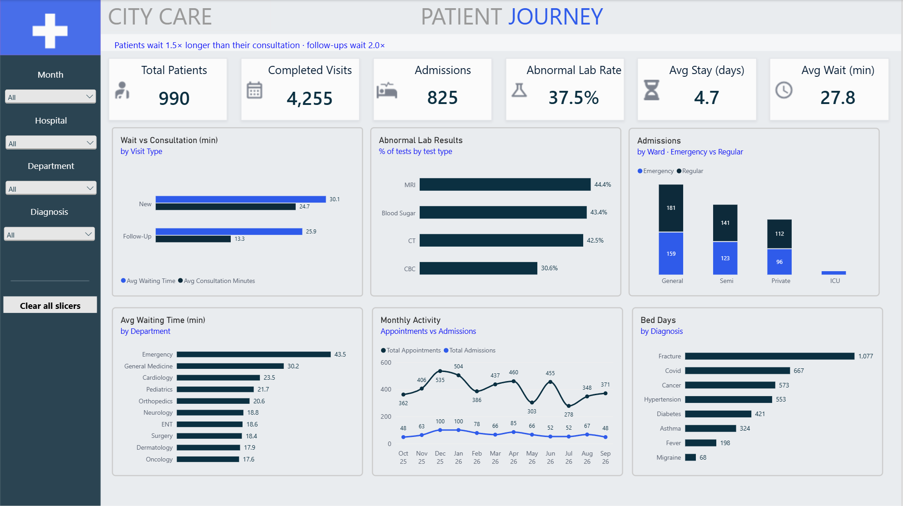

# City Care Hospital Analytics: Patient Journey, Staffing & Revenue

End-to-end healthcare analytics project: **MySQL → SQL data-quality checks & analysis → Power BI**.
Three dashboard pages answer the questions a hospital operations director asks every month:
*Where do patients wait? Are doctors used where demand is? Where does the money come from, and what is still unpaid?*



---

## Key findings

| Area | Finding | So what |
|---|---|---|
| **Access** | Patients wait **1.5×** their consultation time; follow-ups wait **2×** their 13-minute consult | Follow-up slots are too short for the queue in front of them |
| **Access** | **1 in 8** booked slots is lost (8.2% no-show, 4.0% cancelled); follow-ups no-show more (9.7% vs 6.4%) | Target reminders at follow-up visits |
| **Capacity** | General Medicine handles **42%** of all visits and has the longest planned wait (**30 min**) | First candidate for extra clinic sessions |
| **Staffing** | Orthopedics' 2 doctors carry **251 appointments each**, 2× the clinic average of 121; Dermatology runs at **61%** slot use | Capacity exists, but not where demand is |
| **Inpatient** | Fracture, Covid and Cancer use **60%** of all bed days; Fracture leads on volume, Cancer on stay length (8.2 days) | Bed planning should follow these three |
| **Quality** | **14.2%** of admissions are 30-day readmissions, led by Cancer (21%), Diabetes (20%) and Hypertension (20%) | Chronic-condition discharge follow-up is the lever |
| **Revenue** | Room (**57%**) and Surgery (**26%**) charges make up 82% of $10.78M revenue | Revenue tracks length of stay: revenue per bed day is flat (~$2.8K) across stay lengths |
| **Cash** | **$1.60M (14.9%)** is unpaid, concentrated in the last two months and among self-pay patients (**45%** pending vs 10–17% for insurers) | Self-pay collections need an earlier payment plan |

All 22 business questions, the SQL behind them and their findings are in [`sql/04_analysis_queries.sql`](sql/04_analysis_queries.sql).

---

## Dashboard

| Page | Question it answers | Screenshot |
|---|---|---|
| **Patient Journey** | Where do patients wait, which conditions fill beds, how does demand move by month? | [view](images/patient_journey.png) |
| **Doctor Staffing & Workload** | Which doctors and departments are overloaded or under-used? | [view](images/doctor_staffing.png) |
| **Revenue & Capacity** | What drives revenue, which payers matter, and what is still unpaid? | [view](images/revenue_capacity.png) |

Design choices: one navy color for data, one blue for the item to notice, a one-line insight under every page title, and slicers for month, hospital, department and diagnosis.

---

## Data

**Synthetic data.** After my data-quality checks showed the original sample was unusable (see below), the dataset was regenerated with an AI-assisted Python script ([`python/generate_synthetic_data.py`](python/generate_synthetic_data.py)) to my specification, using published clinical and payer norms: length of stay by diagnosis, US payer mix, outpatient no-show rates, and seasonal respiratory peaks. Every assumption is listed in the script's `CONFIG` section, so any pattern on the dashboard can be traced back to it.

| Table | Rows | Table | Rows |
|---|---:|---|---:|
| Patients | 1,000 | Lab tests | 2,678 |
| Appointments | 4,845 | Prescriptions | 5,493 |
| Admissions | 825 | Doctor schedule | 1,280 |
| Bills | 825 | Doctors / Departments / Hospitals | 48 / 24 / 5 |

Coverage: **Oct 2025 – Sep 2026** (12 months) for every table. Data model: 11 tables in MySQL with enforced foreign keys.

---

## Data quality: what I found and how I fixed it

The project started from a 100-patient sample. Before building any visuals, I wrote [`sql/03_data_quality_checks.sql`](sql/03_data_quality_checks.sql) (9 checks: coverage, category values, admission logic, billing reconciliation, ranges, duplicates, cross-table consistency). It found that the sample **could not support department- or hospital-level analysis**:

| Check | Mismatches in the original sample |
|---|---:|
| Appointment hospital vs its doctor's hospital | 165 of 200 |
| Admission department vs its doctor's department | 75 of 80 |
| Admission hospital vs its department's hospital | 60 of 80 |
| Bill patient vs its admission's patient | 79 of 80 |
| Tables covering different periods | Labs ended in April, schedules in February |

**Fix:** I set a source-of-truth rule based on the organization (Department → Hospital, Doctor → Department, Encounter → Doctor, Bill → Admission), repaired the keys ([`sql/archive/02b_repair_keys.sql`](sql/archive/02b_repair_keys.sql)), and then regenerated the data with those rules enforced, scaling it to 1,000 patients over 12 months. The current dataset passes all checks with **0 mismatches**, and every bill reconciles to the cent.

Two loading issues were also fixed in [`sql/02_load_data.sql`](sql/02_load_data.sql): Windows line endings (`'Pending\r'` silently failing `= 'Pending'`), and blank values loading as `0` instead of `NULL`, which would understate average waits and stays.

---

## Repository

```
├── README.md
├── data/                       11 CSVs (input to MySQL)
├── python/
│   └── generate_synthetic_data.py
├── sql/
│   ├── 01_create_tables.sql        schema, keys, indexes
│   ├── 02_load_data.sql            bulk load with CRLF / NULL handling
│   ├── 03_data_quality_checks.sql  9 checks, each with its expected result
│   ├── 04_analysis_queries.sql     22 business questions + findings
│   └── archive/02b_repair_keys.sql fix applied to the original sample
├── powerbi/
│   └── HospitalPowerBIDashboard.pbix
└── images/                     dashboard screenshots
```

## How to run

1. (Optional) `python python/generate_synthetic_data.py data` regenerates the CSVs; seed 42 gives the same data
2. In MySQL 8: run `sql/01_create_tables.sql`, then `sql/02_load_data.sql` (update the CSV path at the top; requires `local_infile`)
3. Run `sql/03_data_quality_checks.sql`: every check should match its stated clean result
4. Open `powerbi/HospitalPowerBIDashboard.pbix` and refresh against your MySQL connection

## Tools

MySQL 8 · SQL (CTEs, window functions, conditional aggregation, data-quality testing) · Power BI (DAX measures, conditional formatting, dynamic text, date table) · Python used only for synthetic data generation (AI-assisted)

## Limitations

- Synthetic data: patterns reflect documented assumptions, not a real hospital.
- Lab tests link to patients, not to a specific stay, so lab-vs-stay analysis is patient-level.
- The dataset is a patient sample, so bed occupancy against physical bed counts is not reported.

---

**Genet Tesfamichael**: Data Analyst · SQL · Power BI
